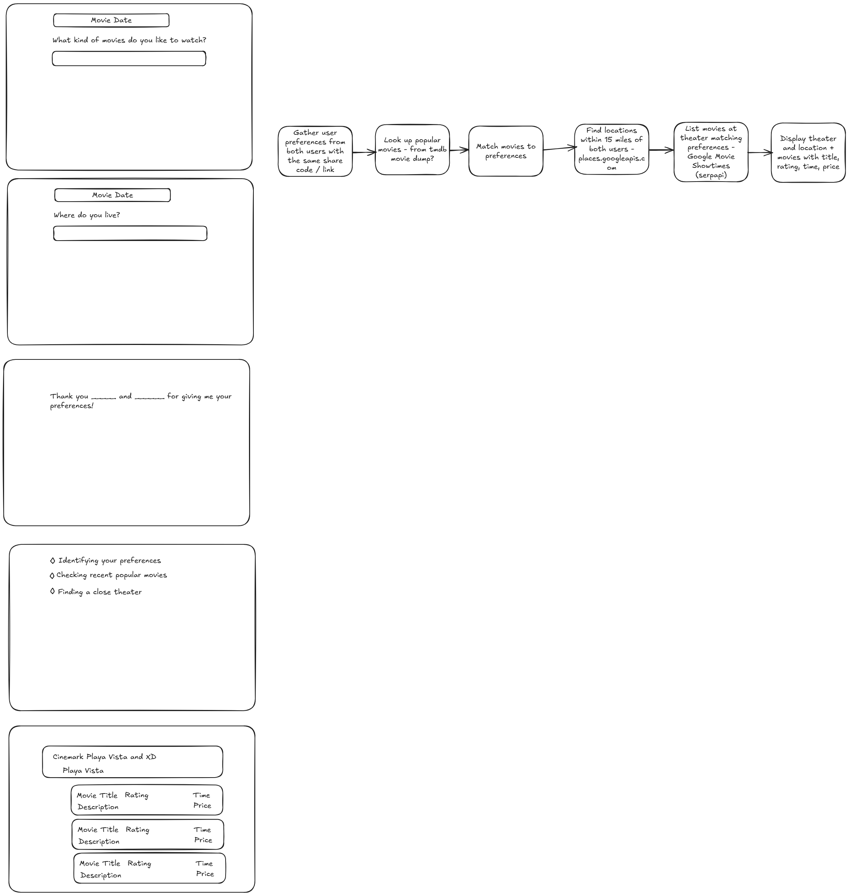

# Reel-Match 🎬

An AI movie-date assistant. Two people tell it what kind of movie they're in the mood for and where they are, and it finds three movies playing in theaters right now that work for both of them.

## Why I built it

My boyfriend and I kept getting stuck at the same point every date night: picking a movie. We rarely wanted the same thing, and we'd spend way too long scrolling through showtimes before giving up. So I built an app to settle it for us.

**Fun fact:** he's my fiancé now, so it seems Reel-Match did its job. 💍

> **Status:** The live deployment (reel-match.com on AWS EKS) is paused to save on AWS costs. The code and Kubernetes manifests are all here, and the app runs locally in a couple of minutes (see [Run it locally](#run-it-locally)).



## How it works

1. Both users open the same chat. The assistant greets them and asks each person, one question at a time, for their preferred genre and their location.
2. Once it has all four answers, the agent runs **one** web search for movies currently playing near both locations.
3. It replies with three recommendations, each with a movie title, a specific theater, and a short reason it's a good pick for both people.

Responses stream into the chat token by token over a WebSocket, so the conversation feels live instead of waiting on a full reply.

## Tech stack

| Layer | Tools |
|---|---|
| Frontend | Vanilla JavaScript, HTML, CSS |
| Backend | Python, FastAPI, WebSockets, Uvicorn |
| AI | OpenAI Agents SDK, `gpt-5-mini`, built-in web search tool |
| Infra | Docker, Amazon ECR, Amazon EKS, AWS Application Load Balancer, ACM (TLS) |

## Architecture

```
Browser (JS chat UI)
   │  WebSocket: /ws/{session_id}
   ▼
AWS ALB  (HTTPS on 443, TLS via ACM, WebSocket enabled)
   │
   ▼
EKS: Service (ClusterIP :80) → Pod (FastAPI :3000)
   │
   ▼
OpenAI Agents SDK  →  Movie Date Agent  →  Web search tool
```

### Backend (`app/server.py`)

- **WebSocket session manager.** Each browser connection gets its own session ID, agent instance, and `OpenAIConversationsSession`, so conversation history is kept per session.
- **Streaming.** The server runs the agent with `Runner.run_streamed` and forwards text deltas to the browser as `assistant_response_delta` events, followed by `response_complete` when the run ends.
- **Non-blocking runs.** Each agent run is started as its own `asyncio` task, so the WebSocket receive loop stays responsive while the model is working.
- **Health check.** `GET /api/health` returns `200`. Kubernetes readiness/liveness probes and the ALB health check both use it.

### Agent (`app/agent.py`)

A single agent built with the OpenAI Agents SDK. Its instructions enforce a strict conversation flow (one question at a time, User 1 then User 2) and limit it to **one** web search after all answers are collected, which keeps latency and cost down. Recommendations must be real movies in current wide release, matched to both users' genres.

### Structured output prototype

Before the real-time app, I prototyped the recommendation logic as a CLI script (`example.py`) using the OpenAI Responses API with web search. It returns a friendly explanation plus a JSON object (theaters, addresses, movies, ratings, showtimes, reasons). The schema lives in `JSON_schema.py`, a sample output is in `recommendation.json`, and the server exposes it at `GET /api/recommendation`.

## Deployment (AWS EKS)

Manifests are in [`k8s/`](k8s/):

- **`deployment.yaml`:** Runs the container from ECR with readiness and liveness probes on `/api/health`, plus CPU and memory requests/limits.
- **`service.yaml`:** ClusterIP service mapping port 80 to the container's port 3000.
- **`ingress.yaml`:** Internet-facing ALB through the AWS Load Balancer Controller, with HTTPS on 443 using an ACM certificate, WebSocket support, IP target type, and the health check pointed at `/api/health`.
- **`target-group-binding.yaml`:** Binds the service to the ALB target group.

Deploy flow: build the Docker image → push to ECR → update the image tag in `deployment.yaml` → `kubectl apply -f k8s/`.

## A bug worth telling

After the first EKS deploy, everything worked locally but production was broken in a confusing way: the UI said **connected**, yet messages never got a reply.

- The FastAPI logs looked clean, so the app code wasn't the problem.
- Checking pod status showed pods repeatedly marked unhealthy and restarted.
- The cause was the ALB health check. It was probing the HTTPS traffic port, which never returned a `200`, so the ALB kept marking pods unhealthy. Each WebSocket connected for a moment, then died when its pod was replaced.
- **Fix:** I added a dedicated health endpoint (`/api/health`) that returns `200` and pointed the ALB health check and the Kubernetes probes at it. Production was stable after that.

Lesson: when the symptoms don't make sense at the app layer, look one layer down.

## Run it locally

Requirements: Python 3.12+, [uv](https://docs.astral.sh/uv/), and an OpenAI API key.

```bash
git clone https://github.com/Shuo0503/Reel_Match.git
cd Reel_Match
uv sync

export OPENAI_API_KEY=your-key-here

cd app
uv run python server.py
```

Open http://localhost:3000, click **Connect**, and chat as User 1 and User 2.

Or with Docker:

```bash
docker build -t reel-match .
docker run -p 3000:3000 -e OPENAI_API_KEY=your-key-here reel-match
```

## What I'd do next

- **Shared session state:** Conversation state currently lives in memory on one pod. Scaling past one replica would need sticky sessions or a shared store such as Redis.
- **Structured output in the live app:** Bring the JSON schema from the prototype into the agent so the UI can render recommendations as cards instead of plain text.
- **Cheaper hosting for the demo:** Run a single container on a lower-cost host so there's always a live demo, and keep EKS for when it needs to scale.
